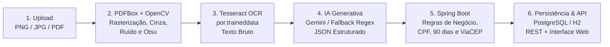

# 📄 Validação Inteligente de Documentos (MVP)


Sistema web e API REST para **validação automatizada de comprovantes de residência** (contas de água, luz, gás e telecomunicações), desenvolvido no âmbito da **Residência Tecnológica — Mentoria Avanade & CESAR School (Grow Up 2026.2)**.

A solução combina **Visão Computacional (OpenCV)**, **Reconhecimento Óptico de Caracteres (Tesseract OCR)**, **Inteligência Artificial Generativa (Google Gemini)** com **fallback local via Regex**, integração com **ViaCEP** e um **Motor de Regras de Negócio em Java / Spring Boot** para reduzir a conferência manual, evitar fraudes e fornecer feedback claro de aprovação ou rejeição em segundos.

---

## 📑 Índice

- [🎯 Problema e Proposta de Valor](#-problema-e-proposta-de-valor)
- [🏗️ Arquitetura e Pipeline de Processamento](#️-arquitetura-e-pipeline-de-processamento)
- [🧰 Stack Tecnológica](#-stack-tecnológica)
- [⚖️ Regras de Negócio e Critérios de Decisão](#️-regras-de-negócio-e-critérios-de-decisão)
- [📁 Estrutura do Projeto](#-estrutura-do-projeto)
- [⚙️ Pré-requisitos e Instalação](#️-pré-requisitos-e-instalação)
- [🚀 Como Executar](#-como-executar)
  - [Modo 1: Rápido com Banco H2 em Memória](#modo-1-rápido-com-banco-h2-em-memória)
  - [Modo 2: Completo com PostgreSQL via Docker](#modo-2-completo-com-postgresql-via-docker)
- [🔌 Endpoints da API e Interfaces](#-endpoints-da-api-e-interfaces)
- [🧪 Suíte de Cenários de Teste](#-suíte-de-cenários-de-teste)
- [🛠️ Solução de Problemas Comuns (Troubleshooting)](#️-solução-de-problemas-comuns-troubleshooting)
- [🗺️ Evoluções Futuras (Roadmap)](#️-evoluções-futuras-roadmap)
- [👥 Créditos e Contexto Acadêmico](#-créditos-e-contexto-acadêmico)

---

## 🎯 Problema e Proposta de Valor

### O Problema
Equipes de **Backoffice, Cadastro, Compliance, RH e Financeiro** ainda realizam a conferência manual de comprovantes de residência enviados por clientes e colaboradores. Esse processo manual acarreta:
- **Lentidão** no onboarding e filas de aprovação;
- **Alto custo operacional** e retrabalho com reenvios sem explicação clara;
- **Erros humanos** na digitação de CPF, datas e endereços;
- **Vulnerabilidade a fraudes** (documentos vencidos, adulterados, incompletos ou ilegíveis).

### A Solução (MVP)
Automatizar o fluxo completo de ponta a ponta para **Comprovantes de Residência** (imagens `.png`, `.jpg`, `.jpeg` e arquivos `.pdf`):
1. Receber o arquivo via interface web ou endpoint REST;
2. Tratar visualmente a imagem para maximizar a leitura;
3. Extrair o texto bruto via OCR;
4. Estruturar os campos em JSON padronizado usando IA (lidando com diferentes layouts de concessionárias);
5. Aplicar validações objetivas e determinísticas em Java;
6. Persistir o resultado e os motivos detalhados para auditoria e consulta.

---

## 🏗️ Arquitetura e Pipeline de Processamento



| Etapa | Tecnologia | Responsabilidade Principal |
| :--- | :--- | :--- |
| **1. Entrada** | Spring Web (`MultipartFile`) + Apache PDFBox | Recebimento do documento (`.jpg`, `.jpeg`, `.png`, `.pdf`) e conversão da página PDF em imagem de alta resolução. |
| **2. Pré-processamento** | OpenCV (`javacv-platform`) | Conversão para escala de cinza, suavização/remoção de ruído (Gaussian Blur), binarização (Otsu) e melhoria de nitidez/contraste. |
| **3. OCR** | Tesseract OCR (Tess4J + `por.traineddata`) | Reconhecimento óptico de caracteres em português, gerando o texto bruto da fatura. |
| **4. Extração Semântica** | Google Gemini (`gemini-3.5-flash-lite`) + Fallback Regex | Interpretação de layouts heterogêneos (faturas de energia, água, gás, internet, DANFE) e normalização em JSON estrito (`DadosDocumentoDTO`), sem inventar campos ausentes (`null`). |
| **5. Motor de Regras** | Java 17+ / Spring Boot + ViaCEP | Validação de legibilidade, obrigatoriedade de campos, algoritmo de dígitos verificadores do CPF, recência (até 90 dias), cruzamento de CEP/Cidade/UF e conferência opcional com o solicitante. |
| **6. Persistência e Exposição** | Spring Data JPA / PostgreSQL 16 (ou H2) / Swagger UI | Armazenamento do histórico de validações para auditoria e retorno do veredito (`APROVADO` ou `REJEITADO`) com motivos claros. |

---

## 🧰 Stack Tecnológica

- **Linguagem & Build:** Java 17+ (compatível com JDK 17 a 23) e Apache Maven
- **Framework Backend:** Spring Boot 3.3.5 (`spring-boot-starter-web`, `spring-boot-starter-data-jpa`)
- **Visão Computacional:** OpenCV via JavaCV (`org.bytedeco:javacv-platform`)
- **OCR:** Tesseract via Tess4J (`net.sourceforge.tess4j:tess4j`) + modelo LSTM `por.traineddata`
- **Manipulação de PDF:** Apache PDFBox
- **Inteligência Artificial:** Google Gemini API (`gemini-3.5-flash-lite`) com mecanismo automático de fallback local via Regex
- **Validação Geográfica:** Integração HTTP com a API pública [ViaCEP](https://viacep.com.br/)
- **Banco de Dados:** PostgreSQL 16 (via Docker Compose) e H2 Database (em memória, para testes rápidos)
- **Documentação & Frontend:** OpenAPI / Swagger UI (`springdoc-openapi`) e interface web embarcada (`src/main/resources/static`)

---

## ⚖️ Regras de Negócio e Critérios de Decisão

### Campos Extraídos (`DadosDocumentoDTO`)
| Campo | Tipo | Finalidade |
| :--- | :--- | :--- |
| `nome` | `String` | Nome completo do titular do comprovante |
| `cpf` | `String` | 11 dígitos numéricos normalizados para validação matemática |
| `endereco` | `String` | Logradouro, número, complemento e bairro |
| `cidade` | `String` | Município de residência |
| `estado` | `String` | Sigla da UF (2 letras, ex.: `PE`, `SP`, `MG`) |
| `cep` | `String` | Código Postal (8 dígitos) para verificação via ViaCEP |
| `dataEmissao` / `dataVencimento` | `LocalDate` (`YYYY-MM-DD`) | Verificação da janela temporal de validade |

### Critérios de Aprovação (`APROVADO`)
O comprovante é **APROVADO** somente quando atende **cumulativamente** a todos os critérios:
1. **Legibilidade mínima:** O OCR retorna texto suficiente e legível após o pré-processamento no OpenCV;
2. **Integridade cadastral:** Todos os campos obrigatórios (`nome`, `cpf`, `endereco`, `cidade`, `estado` e data) foram identificados;
3. **CPF válido:** Possui 11 dígitos, não é sequência repetida (ex.: `111.111.111-11`) e passa no cálculo dos dois dígitos verificadores;
4. **Validade temporal (Recência):** Data válida no calendário, não futura, e dentro do prazo de **até 90 dias** em relação à data atual;
5. **Consistência geográfica (ViaCEP):** Quando informado, o CEP possui formato válido e corresponde à Cidade/UF extraídas;
6. **Correspondência (opcional):** Quando enviados dados do solicitante na requisição, o nome/CPF extraídos conferem com o titular.

### Critérios de Rejeição (`REJEITADO`)
Qualquer falha nas regras acima resulta em status **`REJEITADO`**, acompanhado de uma **lista objetiva de motivos** (ex.: *"Documento ilegível"*, *"CPF inválido"*, *"Comprovante vencido há mais de 90 dias"*, *"Campo obrigatório ausente: nome"*, *"Divergência entre CEP e Cidade/UF"*), permitindo orientação imediata ao usuário ou revisão manual pelo backoffice.

---

## 📁 Estrutura do Projeto

```text
validacao-documentos-mvp/
├── docker-compose.yml                         # Container PostgreSQL 16 (porta 5433:5432)
├── pom.xml                                    # Dependências Maven (Spring Boot, JavaCV, Tess4J, PDFBox, JPA)
├── tessdata/
│   └── por.traineddata                        # Modelo LSTM em português do Tesseract OCR
└── src/
    └── main/
        ├── java/com/avanade/cesar/validacao/
        │   ├── ValidacaoDocumentosApplication.java
        │   ├── controller/                    # Endpoints REST de upload, texto e histórico
        │   ├── dto/                           # Records Java (DadosDocumentoDTO, ResultadoValidacaoDTO)
        │   ├── entity/                        # Entidade JPA para persistência das validações
        │   ├── repository/                    # Interface Spring Data JPA
        │   └── service/
        │       ├── ImagePreprocessService.java # Pré-processamento OpenCV + PDFBox
        │       ├── OcrService.java             # Extração de texto com Tess4J
        │       ├── AiExtractionService.java    # Integração Gemini + Fallback Regex
        │       ├── ValidacaoRegraService.java  # Motor de regras (CPF, 90 dias, campos, ViaCEP)
        │       └── DocumentoValidacaoService.java # Orquestrador do pipeline
        └── resources/
            ├── application.properties          # Configuração padrão (H2 + IA + Tesseract)
            ├── application-postgres.properties # Profile PostgreSQL (porta 5433)
            └── static/                         # Interface Web (HTML/CSS/JS) para demonstração
```

---

## ⚙️ Pré-requisitos e Instalação

### 1. Ferramentas Necessárias
- **Java JDK 17 ou superior** (`java -version`)
- **Apache Maven 3.8+** (`mvn -version`)
- **Docker e Docker Compose** *(opcional — necessário apenas se for usar PostgreSQL em container)*
- **Chave de API do Google Gemini** *(opcional — obtida gratuitamente no [Google AI Studio](https://aistudio.google.com/apikey); sem chave, o sistema opera em modo fallback local via Regex)*

### 2. Clone o Repositório
> ⚠️ **Atenção no Windows:** clone o projeto em um caminho **sem exclamações (`!`), sem acentos e sem espaços** (exemplo: `D:\dev\validacao-documentos-mvp`). O caractere `!` quebra o *classloader* do Java ao executar via Maven, e acentos/espaços podem causar falhas nas bibliotecas nativas do OpenCV e Tesseract.

```bash
git clone https://github.com/pablotambor/ia_valida.git
cd validacao-documentos-mvp
```

### 3. Baixe o Modelo de Idioma do Tesseract (`por.traineddata`)
O Tesseract precisa do arquivo treinado de língua portuguesa dentro da pasta `tessdata/` na raiz do projeto:

```bash
mkdir -p tessdata
curl -L -o tessdata/por.traineddata https://github.com/tesseract-ocr/tessdata_fast/raw/main/por.traineddata
```

*(Alternativamente, baixe manualmente em [tesseract-ocr/tessdata_fast](https://github.com/tesseract-ocr/tessdata_fast/blob/main/por.traineddata) clicando em **Download raw file** e salve em `tessdata/por.traineddata`.)*

---

## 🚀 Como Executar

> 🔒 **Segurança:** nunca salve sua `GEMINI_API_KEY` dentro do `application.properties` nem faça commit de chaves no GitHub. Sempre informe via variável de ambiente.

### Modo 1: Rápido com Banco H2 em Memória
Ideal para subir imediatamente e demonstrar o pipeline sem precisar de Docker ou PostgreSQL instalado. Os dados ficam em memória RAM enquanto a aplicação estiver ativa.

**Linux / macOS / Git Bash (Windows):**
```bash
export AI_PROVIDER=gemini
export GEMINI_MODEL=gemini-3.5-flash-lite
export GEMINI_API_KEY="SUA_CHAVE_GEMINI_AQUI"

mvn spring-boot:run
```

**PowerShell (Windows):**
```powershell
$env:AI_PROVIDER="gemini"
$env:GEMINI_MODEL="gemini-3.5-flash-lite"
$env:GEMINI_API_KEY="SUA_CHAVE_GEMINI_AQUI"

mvn spring-boot:run
```

*(Para testar **sem chave de IA**, usando apenas o extrator local por Regex, basta rodar `mvn spring-boot:run` diretamente.)*

---

### Modo 2: Completo com PostgreSQL via Docker
Ideal para persistência real em disco. O `docker-compose.yml` e o `application-postgres.properties` utilizam a porta **`5433`** no host (`5433:5432`) para evitar conflito caso já exista um PostgreSQL local instalado no Windows na porta padrão `5432`.

1. **Suba o container do PostgreSQL:**
   ```bash
   docker-compose up -d
   ```
   *(Confirme com `docker ps` que o container `validacao-docs-postgres` está ativo na porta `5433->5432`.)*

2. **Inicie a aplicação com o profile `postgres`:**
   ```bash
   export AI_PROVIDER=gemini
   export GEMINI_MODEL=gemini-3.5-flash-lite
   export GEMINI_API_KEY="SUA_CHAVE_GEMINI_AQUI"

   mvn spring-boot:run -Dspring-boot.run.profiles=postgres
   ```

---

## 🔌 Endpoints da API e Interfaces

Com a aplicação rodando, acesse:

| Recurso | URL | Descrição |
| :--- | :--- | :--- |
| **Interface Web (Demo)** | `http://localhost:8080` | Tela de upload de comprovantes, teste por texto simulado e visualização do histórico |
| **Swagger UI (OpenAPI)** | `http://localhost:8080/swagger-ui.html` | Documentação interativa para testar todos os endpoints REST |
| **Console H2** *(Modo H2)* | `http://localhost:8080/h2-console` | Visualização das tabelas em memória |

### Principais Endpoints REST

| Método | Endpoint | Content-Type | Descrição |
| :--- | :--- | :--- | :--- |
| `POST` | `/api/documentos/validar` | `multipart/form-data` | Recebe o arquivo (`file` em PNG/JPG/PDF) e dados opcionais do solicitante, executa todo o pipeline e retorna o resultado. |
| `POST` | `/api/documentos/validar-texto` | `application/json` | Valida diretamente um texto simulado de fatura (útil para testar IA + Regras sem imagem). |
| `GET` | `/api/documentos` | `application/json` | Lista o histórico de documentos validados salvos no banco de dados. |
| `GET` | `/api/documentos/{id}` | `application/json` | Consulta os detalhes completos e motivos de uma validação específica. |

#### Exemplo de Requisição via `curl` (Upload de Imagem/PDF)
```bash
curl -X POST "http://localhost:8080/api/documentos/validar" \
  -F "file=@./exemplos/fatura-compesa.jpg"
```

#### Exemplo de Resposta JSON
```json
{
  "id": 1,
  "status": "APROVADO",
  "motivos": [],
  "dadosExtraidos": {
    "nome": "Mariana Oliveira Cavalcanti",
    "cpf": "52998224725",
    "endereco": "Rua do Espinheiro, 412, Apto 302",
    "cidade": "Recife",
    "estado": "PE",
    "cep": "52020-020",
    "dataEmissao": "2026-11-02"
  },
  "processadoEm": "2026-11-25T16:45:12"
}
```

---

## 🧪 Suíte de Cenários de Teste

Para comprovar a robustez do pipeline de **OpenCV + Tesseract + Gemini + Motor de Regras**, o projeto foi validado com **18 cenários heterogêneos** abrangendo diferentes concessionárias, layouts reais, ruídos visuais e falhas intencionais:

### 1. Cenários de Layout e Recência (70% Aprovados / 30% Vencidos)
| ID | Empresa / Serviço | Desafio de Reconhecimento | Resultado Esperado |
| :-: | :--- | :--- | :---: |
| **01** | Compesa (Água) | Layout padrão limpo (linha de base) | ✅ `APROVADO` |
| **02** | Vivo Fibra (Internet) | CNPJ e endereço da sede concorrentes + múltiplas datas + linha digitável | ✅ `APROVADO` |
| **03** | Copergás (Gás) | Formato DANFE P&B com bloco postal sem rótulos explícitos | ✅ `APROVADO` |
| **04** | Claro Residencial | Banners promocionais intercalados + datas distrativas + leve ruído | ✅ `APROVADO` |
| **05** | Enel SP (Energia) | Tabela tarifária densa + abreviações (`END.`, `CID/UF`) + bandeira | ✅ `APROVADO` |
| **06** | Brisanet (Fibra) | CPF sem pontuação + endereço em 2 linhas + QR Code PIX | ✅ `APROVADO` |
| **07** | TIM Ultrafibra | Caso de borda (84 dias) + carimbo diagonal `"PAGO VIA PIX"` + ruído de toner | ✅ `APROVADO` |
| **08** | Sabesp (Água) | Caso de borda vencido (97 dias) + quadro de hidrômetro | ❌ `REJEITADO` |
| **09** | Cemig (Energia) | Vencida (> 90 dias) + nota fiscal poluída + CNPJ próximo ao CPF | ❌ `REJEITADO` |
| **10** | Neoenergia Coelba | Vencida (> 90 dias) + data por extenso + texto corrido sem rótulos | ❌ `REJEITADO` |

### 2. Cenários Negativos de Integridade e Qualidade (Casos de Erro)
| ID | Empresa | Inconsistência / Ausência Testada | Regra Acionada |
| :-: | :--- | :--- | :--- |
| **E01** | Neoenergia PE | Nome do titular ausente + CPF matematicamente inválido (`123.456.789-00`) | Campos obrigatórios + Dígitos verificadores |
| **E02** | Águas do Rio | Divergência geográfica (`Recife` + `UF: RJ` + `CEP: 01310-100`) | Consistência de endereço / ViaCEP |
| **E03** | Algar Telecom | CPF, endereço e CEP totalmente ausentes | Campos obrigatórios |
| **E04** | Comgás | Data de emissão futura + vencimento anterior à emissão | Integridade cronológica |
| **E05** | CPFL Energia | CPF com dígitos repetidos (`111.111.111-11`) + Cidade e UF ausentes | Validação de CPF + Campos obrigatórios |
| **E06** | Copasa | Ausência total de data de emissão e data de vencimento | Obrigatoriedade de data |
| **E07** | Oi Fibra | UF inexistente (`XX`) + CEP malformado + data impossível (`31/02/2026`) | Parsing seguro de data + UF/CEP |
| **E08** | Equatorial Energia | Fotocópia com manchas, baixo contraste, vincos e ruído severo | OpenCV + Legibilidade mínima no OCR |

---

## 🛠️ Solução de Problemas Comuns (Troubleshooting)

| Sintoma / Erro | Causa Provável | Solução |
| :--- | :--- | :--- |
| `ClassNotFoundException: ValidacaoDocumentosApplication` no Windows | Pasta do projeto contém `!`, espaços ou acentos (ex.: `!CESAR`, `Período`). | Mova o projeto para um caminho limpo como `D:\dev\validacao-documentos-mvp` e rode `mvn clean spring-boot:run`. |
| `FATAL: autenticação do tipo senha falhou para o usuário "postgres"` | Existe um PostgreSQL local no Windows ocupando a porta `5432`. | Use a porta `5433:5432` no `docker-compose.yml` e `5433` no `application-postgres.properties`, depois execute `docker-compose down && docker-compose up -d`. |
| Erro `404` na chamada da API do Gemini | Modelo antigo (`gemini-2.0-flash`) descontinuado. | Defina `GEMINI_MODEL=gemini-3.5-flash-lite` (ou `gemini-3.8-flash`). |
| Sistema cai sempre no fallback Regex | Variável `GEMINI_API_KEY` não exportada na sessão atual ou `AI_PROVIDER` diferente de `gemini`. | Exporte `AI_PROVIDER=gemini` e `GEMINI_API_KEY` no mesmo terminal antes de executar o Maven. |
| Erro do Tesseract (`Error opening data file ... por.traineddata`) | Arquivo de idioma português ausente na pasta `tessdata/`. | Baixe o `por.traineddata` conforme a seção [Pré-requisitos e Instalação](#3-baixe-o-modelo-de-idioma-do-tesseract-portraineddata). |

---

## 🗺️ Evoluções Futuras (Roadmap)

- [ ] Suporte a **Documentos de Identificação (RG e CNH)** e **Comprovantes de Renda** com validação cruzada entre documentos;
- [ ] Opção de extração **multimodal direta** (envio da imagem ao Gemini Vision) como alternativa comparável ao pipeline OCR clássico;
- [ ] Processamento assíncrono em lote via mensageria (RabbitMQ / Kafka) para alto volume de backoffice;
- [ ] Autenticação e controle de acesso (Spring Security + JWT) e armazenamento de arquivos em Object Storage (S3 / Azure Blob);
- [ ] Dashboard analítico com métricas de taxa de aprovação, principais motivos de recusa e acurácia de OCR (CER/WER).

---

## 👥 Créditos e Contexto Acadêmico

Projeto desenvolvido na disciplina de **Residência Tecnológica — Etapa Grow Up (2026.2)** da **CESAR School** (Curso de Análise e Desenvolvimento de Sistemas), em parceria com a mentoria da **Avanade**.

- **Arquitetura de Referência:** Mentoria Avanade 2026.2 (Prof. Kleber Meira)
- **Equipe / Autores:**
  - *Pablo Tamborini Nogueira - https://github.com/pablotambor/i*

---

<p align="center">
  <em>"Tecnologia com propósito transforma realidades."</em> — CESAR School & Avanade 2026.2
</p>
